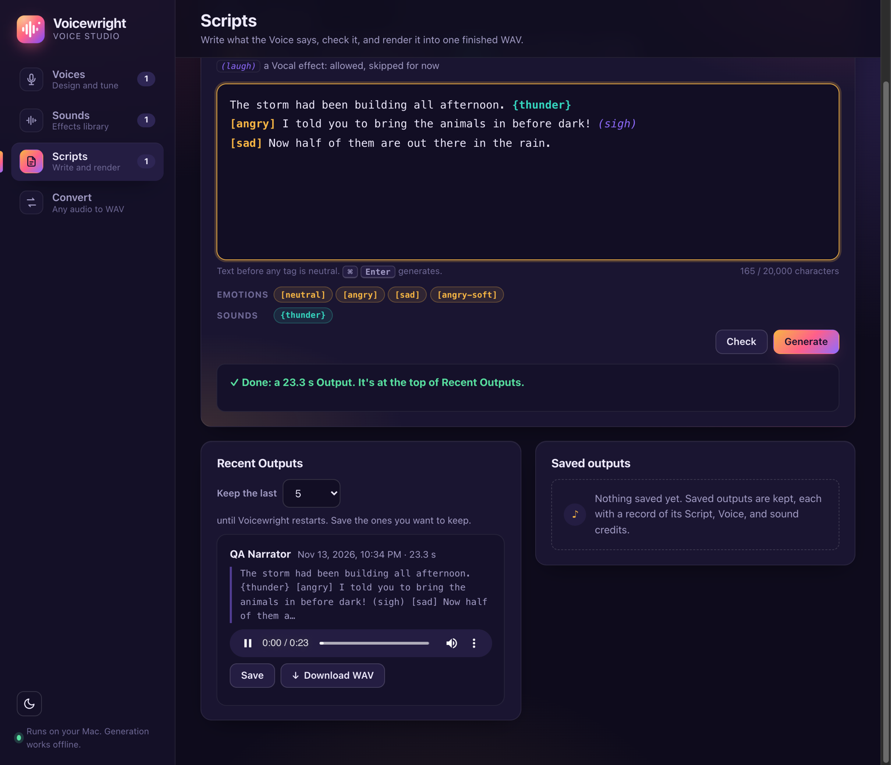

# Voicewright

Design a voice from a description, then have it read your Scripts, with emotions and sound effects, into one finished WAV. Everything runs locally on a Mac, using free and open-source AI models, and generation works offline.



**Hear it:** [sample-output.wav](docs/media/sample-output.wav) (23 s). This is an Output exactly as the app rendered it during the offline smoke test, unedited. The Voice was designed from *"A gravelly older man with a slow, calm, warm voice,"* and it reads this Script:

```text
The storm had been building all afternoon. {thunder}
[angry] I told you to bring the animals in before dark!
[sad] Now half of them are out there in the rain.
```

Thunder: ["Huge Thunder Crack [XY + MS]"](https://freesound.org/people/-CASK-/sounds/732992/) by -CASK-, licensed under [CC BY 4.0](https://creativecommons.org/licenses/by/4.0/).

## What it does

- **Voices:** describe a voice in plain words. Qwen3-TTS designs a neutral Reference clip plus one Emotion preset each for angry, sad, and excited. Review each clip: regenerate it, tune its exaggeration and cfg, or go back to an earlier take. Then keep the Voice under a name.
- **Sounds:** search Freesound from the page, preview each result and check its license, then add it to a local Sound library as standard WAV with its credit.
- **Scripts:** write `[emotion]` and `{sound}` tags inline. Check lists every problem at once. Generate speaks each line with Chatterbox and assembles one WAV with short gaps and even volume.
- **Outputs:** the last 5 to 10 Outputs are kept until restart. Save the ones you want, each with a JSON record of its Script, Voice, preset values, and sound credits.
- **Convert:** turn any audio or video file into the app's standard WAV.

See [CHANGELOG.md](CHANGELOG.md) for what each version added.

## Run it

Needs macOS with Python 3.11 or 3.12 (3.13 and newer won't work with the speech model).

1. `brew install python@3.11 ffmpeg`
2. `python3.11 -m venv .venv && .venv/bin/pip install -e '.[dev,speech,voice-design]'`
3. `.venv/bin/voicewright`

The last step starts the app at <http://127.0.0.1:8765/> and opens it in its own window, then loads the speech model (Chatterbox) in the background. The first run downloads its weights from Hugging Face, about 4 GB; after that it loads in about 15 seconds and uses about 5 GB. `GET /jobs/current` shows the load while it runs, and a failed load is printed in the terminal. Without the `speech` or `voice-design` extra the app still runs, but anything that needs that model says how to install it. To start without loading any model, for working on the page, set `VOICEWRIGHT_NO_MODELS=1`. Running it again while it's up just opens the page, unless `--config` names a config file other than the default one. Use `--port` to pick another port.

The window is an app window from Google Chrome, Microsoft Edge, Brave, or Chromium (the first of these that's installed): no tabs and no address bar. Without one of those, or with `--tab`, or when the `BROWSER` environment variable is set, the page opens in your usual browser instead. In Chrome or Edge you can also install it from the address bar's install button, to get a Dock icon.

### Convert a file

The Convert panel on the page turns an audio or video file (MP3, M4A, FLAC, OGG, AAC, WAV, or a video with sound) into the app's standard WAV, 16-bit mono, and lets you play or download it. The same conversion is `POST /convert` with the file as a form upload named `file`.

### Design a voice

The Voices area of the page does all of this: describe a voice and design it, then review each clip (play it, regenerate it, go back to an earlier take, or move the exaggeration and cfg sliders and hear the result), and accept it under a name or discard it. Draft voices left open show up there to resume. Saved Voices can be edited in place: hear new values, regenerate a preset, add a custom one, then accept or reject each new take. A bar at the top shows the running job and its step. A take you make plays as soon as it's ready, an open Voice card stays open while you work on it, and an error shows next to the button that caused it. The API behind it:

`POST /voices/design` with `{"description": "A gravelly older man, slow and calm."}` starts a job that designs a Draft voice. Qwen3-TTS designs the neutral clip, then one Emotion preset for each emotion in the Default emotion set (`GET /emotions/defaults`). The first run downloads its weights, about 8 GB. Follow the job at `GET /jobs/{id}`. Its result names the Draft voice: `GET /voices/drafts/{id}` lists its presets, and each preset's `clip_url` plays the clip. Draft voices are kept in the data folder's `drafts` folder and survive a restart.

To review a Draft voice, each of these starts a job and adds a take; no take is deleted while the draft is open:

- `POST /voices/drafts/{id}/presets/{emotion}/regenerate` designs a new take of one preset, or of the neutral clip.
- `POST /voices/drafts/{id}/presets/{emotion}/retune` with `{"exaggeration": 0.9, "cfg": 0.2}` speaks the preset's sample at those values, so you can hear them, and keeps them.
- `POST /voices/drafts/{id}/redesign` with `{"description": "…"}` changes the description and designs every preset again.

`PUT /voices/drafts/{id}/presets/{emotion}` with `{"take": "angry-1"}` goes back to an earlier take.

When the Draft voice sounds right, `POST /voices` with `{"draft_id": "…", "name": "Old Narrator"}` saves it to the library, in the data folder's `voices` folder, and removes the draft and its takes. A name already taken, ignoring case, gets 409. `DELETE /voices/drafts/{id}` discards a draft instead. `GET /voices/drafts` lists the drafts still open, for picking up after a restart. `GET /voices` lists saved Voices with their presets.

To edit a saved Voice, each of these starts a job that makes a pending take. The Voice changes only when you accept it (`POST /voices/{id}/takes/{take}/accept`); rejecting it (`DELETE /voices/{id}/takes/{take}`) leaves the preset as it was:

- `POST /voices/{id}/presets` with `{"name": "angry-soft"}` adds a custom preset. `sample`, `exaggeration`, and `cfg` are optional; the values start from neutral's.
- `POST /voices/{id}/presets/{emotion}/regenerate` designs a new clip for a preset. The neutral clip is locked, so this is refused for neutral.
- `POST /voices/{id}/presets/{emotion}/retune` with new values lets you hear them first.

`DELETE /voices/{id}/presets/{emotion}` removes any preset but neutral, and `DELETE /voices/{id}` deletes the Voice. The description can't be edited once the Voice is saved.

### Sound library

Sound effects in a Script, written `{explosion}`, play sounds from the local Sound library. The Sounds area of the page lists the library (play, replace, remove) and searches Freesound: play each result's preview, check its license, name it, and add it, or pick one to replace a sound. Each sound is kept under its name in the data folder's `sounds` folder, as standard WAV with its credit: title, author, license, source, and an attribution line. Names are lowercase letters, digits, `-` and `_`, and are matched ignoring case, so `{Explosion}` and `{explosion}` are the same sound. `GET /sounds` lists the library, `GET /sounds/{name}/audio` plays a sound, and `DELETE /sounds/{name}` removes one.

Sounds come from Freesound. Searching needs a free API key: get one at <https://freesound.org/apiv2/apply> and put it in the config file as `freesound_api_key`, or set `FREESOUND_API_KEY`. A new key works without a restart. `GET /sounds/search?q=thunder` returns a page of results, each with its preview URL and license. `POST /sounds` with `{"freesound_id": 12345, "name": "thunder"}` downloads that sound, converts it to standard WAV, and keeps it with its credit. A name already taken gets 409. `PUT /sounds/thunder` with `{"freesound_id": 67890}` replaces the sound behind a name. The app keeps Freesound's high-quality preview (OGG, about 192 kbps), since original files need a Freesound login (OAuth2). If there's no key, Freesound refuses it, or it can't be reached, these return 503 with a `reason` of `no_api_key`, `bad_api_key`, or `unreachable`, and the rest of the app keeps working offline.

### Scripts and Outputs

In the Scripts area, pick a saved Voice and write a Script. `[angry]` switches emotion until the next tag, and text before any tag is neutral. `{thunder}` plays a sound from the Sound library. `(laugh)` is a Vocal effect: the Script can have one, but it's skipped with a warning for now. **Check** lists every problem at once: emotions the Voice doesn't have (with a button to add one), sounds that aren't in the library (with a button that searches Freesound for them), and malformed tags with their line and column. Adding the missing emotion or sound checks the Script again.

**Generate** runs the same check, then speaks each line with its emotion's preset and plays the sounds in order. It puts them together as one WAV with short gaps and even volume, showing "Segment 3 of 7" as it goes. The new Output plays when it's ready. The last few Outputs are kept until the app restarts: 5 by default, and the page can set 5 to 10. **Save** keeps one for good in the data folder's `saved` folder, next to a JSON record of the Script, the Voice, the preset values used, and the credit and license of every sound used. Outputs and Saved outputs can be downloaded from the page.

Through the API: `POST /scripts/check` and `POST /scripts/generate` take `{"voice_id": "...", "script": "..."}`. A rejected Script gets 422 with `missing_emotions`, `missing_sounds`, and `parse_errors`, and generating starts no job. `GET /outputs` and `GET /saved` list Outputs and Saved outputs, `POST /outputs/{id}/save` saves one, and `GET /settings` and `PUT /settings` read and change `output_cache_size`.

### Settings and data

On first run the app writes a config file to `~/.config/voicewright/config.toml` (or wherever `--config` points) and creates the app data folder it names, `~/Voicewright` by default, with `voices`, `drafts`, `sounds`, `cache`, and `saved` subfolders. To move the data folder, set `data_folder` to a full path or one starting with `~`. The config file also holds the Output cache size (5 to 10) and your Freesound API key, so it is created readable only by you. Keep it out of git.

## Develop

Before each commit, run the checks:

```sh
.venv/bin/ruff check . && .venv/bin/ruff format --check . && .venv/bin/pytest
```

Tests run the app in-process against a fresh temporary data folder, so they never touch your real config or data. Every engine is faked and no test loads a real model.

The smoke tests load the real models. They render a short line and a 120-word passage, and design a whole Draft voice, then save the audio so you can listen. With a Freesound key set, one more searches Freesound and adds a sound to a temporary library. The full smoke test (`tests/smoke/test_full_smoke.py`) runs the whole flow. It adds a sound, then designs a Voice, accepts it, renders a tagged Script, and saves the Output, all with every connection off this machine refused. Memory pressure must stay out of the red throughout. It's slow and runs only on Apple Silicon, so it's left out of the default run:

```sh
.venv/bin/pytest -m smoke -s
```
